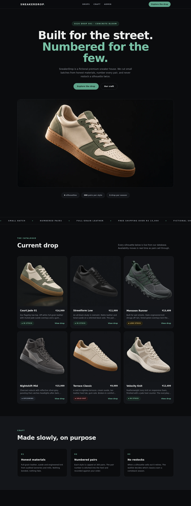
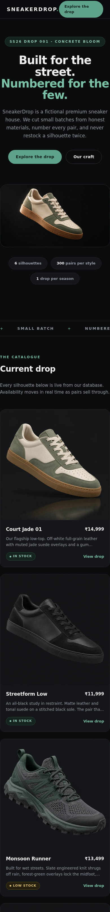
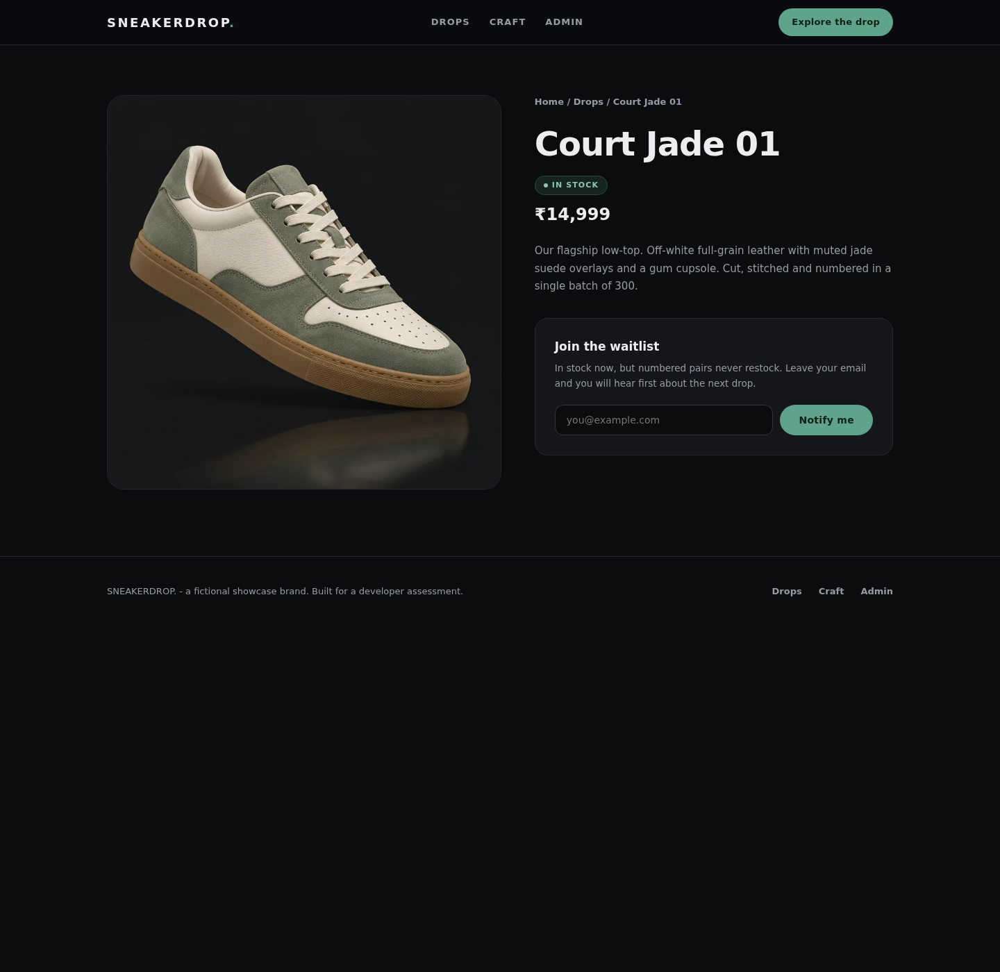
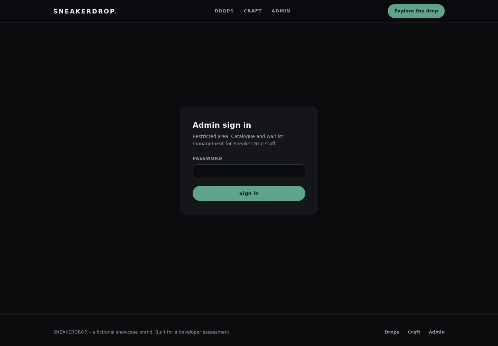

# SneakerDrop

A premium sneaker showcase for the fictional brand **SneakerDrop** - small-batch,
numbered pairs with a live catalogue, a protected admin dashboard, and per-product
waitlists. Built as the web development assignment for a developer internship
application.

> **Authorship note:** this project was built with AI assistance (Instinct) under
> my direction - I set the brief, the design direction and the requirements, and
> reviewed the implementation. Every technical decision below is described in my
> own words so I can explain and defend it.

## Features

- **Landing page** - hero, marquee, live catalogue grid, craft section, CTA.
  Flat charcoal + jade design system, Sora type, reveal-on-scroll micro-interactions
  that respect `prefers-reduced-motion`, fully responsive.
- **Dynamic catalogue** - every product card, price and availability badge is read
  live from a real Postgres database (no hardcoded arrays, no mock API).
- **Product pages** - `/drops/[slug]` with availability state and a waitlist form.
- **Waitlist** - server-validated email, persisted in Postgres, one signup per
  email per product enforced by a unique index, honeypot + rate limiting against bots.
- **Protected admin dashboard** (`/admin`) - session-cookie auth; add / edit /
  delete sneakers, change availability (reflected on the public site immediately),
  and view waitlist submissions per drop.

## Tech stack

- **Next.js 15 (App Router) + React 19 + TypeScript** - server components read from
  the DB at request time; server actions handle admin mutations.
- **Postgres on Neon (free tier)** - serverless driver `@neondatabase/serverless`
  over the pooled connection.
- **Radix Themes + custom CSS** - accessible primitives under a custom flat theme.
- **Vercel** - deployment with the three env vars below.

## Setup

```bash
npm install
cp .env.example .env.local   # fill in the three values
DATABASE_URL=... node scripts/setup-db.mjs   # creates schema + seeds the drop
npm run dev
```

Environment variables:

| Variable | Purpose |
| --- | --- |
| `DATABASE_URL` | Pooled Postgres connection string (Neon in prod) |
| `SESSION_SECRET` | Signs the admin session cookie (`openssl rand -hex 32`) |
| `ADMIN_PASSWORD` | Admin dashboard password (server env only, never in the repo) |

## Database schema

```sql
CREATE TABLE sneakers (
  id uuid PRIMARY KEY DEFAULT gen_random_uuid(),
  name text NOT NULL,
  slug text NOT NULL UNIQUE,
  description text NOT NULL DEFAULT '',
  price_cents integer NOT NULL CHECK (price_cents >= 0),
  availability text NOT NULL DEFAULT 'in_stock'
    CHECK (availability IN ('in_stock','low_stock','sold_out','upcoming')),
  image_url text NOT NULL DEFAULT '',
  created_at timestamptz NOT NULL DEFAULT now()
);

CREATE TABLE waitlist (
  id uuid PRIMARY KEY DEFAULT gen_random_uuid(),
  sneaker_id uuid NOT NULL REFERENCES sneakers(id) ON DELETE CASCADE,
  email text NOT NULL,
  created_at timestamptz NOT NULL DEFAULT now()
);

-- one signup per email per product, case-insensitive
CREATE UNIQUE INDEX waitlist_unique_per_product ON waitlist (sneaker_id, lower(email));
```

`scripts/setup-db.mjs` runs this and seeds six silhouettes.

## Architecture & technical decisions

- **Real DB everywhere.** Public pages are server components that query Postgres
  directly at request time (`force-dynamic`), so admin edits show up on the public
  site without a rebuild. `revalidatePath` is called after every mutation as well.
- **Admin auth without a provider.** The assignment is a single-admin showcase, so
  instead of pulling in an auth service I issue an HMAC-signed, HttpOnly,
  `SameSite=Lax` session cookie (`sd_admin`, 8h expiry) after a timing-safe
  password check against `ADMIN_PASSWORD`. Every admin page *and* every server
  action re-verifies the session server-side; the password and session secret live
  only in server environment variables, so no write capability or credential is
  ever exposed to the client.
- **Brute-force controls.** Login attempts are rate-limited (5 per 10 minutes per
  IP) with a uniform delay on failure; the password comparison hashes both sides
  before `timingSafeEqual` so length never leaks.
- **Waitlist integrity.** Emails are normalized (trim + lowercase) and validated
  server-side; the `(sneaker_id, lower(email))` unique index is the real duplicate
  guard, with a friendly 409 message on conflict. A hidden honeypot field and an
  IP rate limit absorb basic bots.
- **Parameterized queries only** via the Neon serverless driver's tagged
  templates - no string-built SQL anywhere.
- **Original imagery.** All product and hero images are original AI-generated
  studio shots (no brand marks), compressed to WebP - no stock licenses or
  trademark risk for a fictional brand.
- **Prices in paise.** `price_cents` integer avoids float rounding; INR formatting
  happens at render.

## Screenshots

| Desktop landing | Mobile landing | Product page | Admin login |
| --- | --- | --- | --- |
|  |  |  |  |

## Deployment

- Live site: _TBD - filled after deploy_
- Admin: `/admin` (password in server env)

## Known limitations

- Rate limiting is in-memory per serverless instance; a multi-instance deployment
  needs a shared store (e.g. Upstash) for a hard global cap.
- Admin is single-user by design (one password); no roles or audit log.
- Product images are referenced by path/URL, not uploaded through the admin UI.
- Waitlist collects emails only - no confirmation email is sent (no mail service
  in scope for the assignment).
